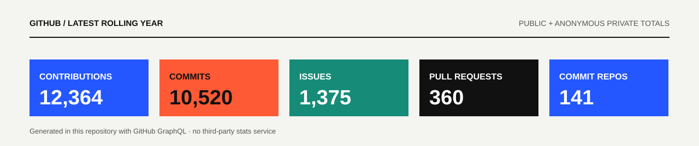
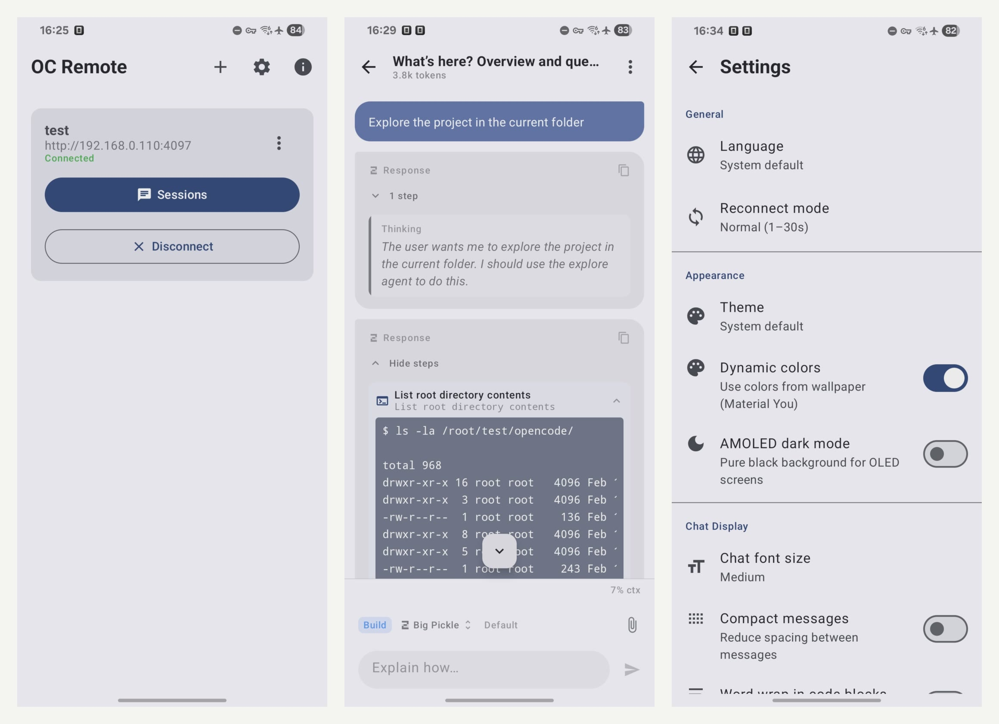
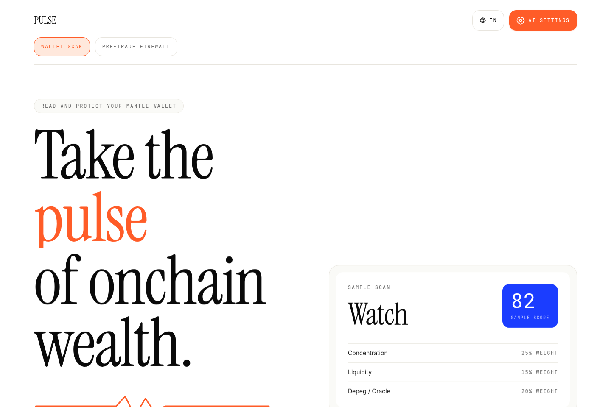

  <picture>
    <source media="(max-width: 600px)" srcset="./assets/hero-mobile.svg" />
    
  </picture>

AI-native 全栈 · 产品、工具与 Agent 系统 · 出身 Minecraft 命令方块

  <a href="https://wuxie233.com">Website</a> ·
  <a href="https://wiki.wuxie233.com/">Neomega Wiki</a> ·
  <a href="https://space.bilibili.com/254160530">Bilibili</a> ·
  <a href="mailto:445714414@qq.com">Email</a>

<picture>
  <source media="(max-width: 600px)" srcset="./assets/github-stats-mobile.svg" />
  
</picture>

## 作品

### Minecraft 指令系统 · 在命令方块里写一整个游戏

空岛、数据化、枪械、类幸存者，每一套都是网易租赁服导入即用的纯指令系统，以付费文件交付给服主，附带长期更新和售后。

最新一代空岛一条龙有 116 条命令链、7295 个命令方块。每条链都有链首门控，服里有人但没人触发功能时，每 tick 只跑三百来个。它是圈内第一个把岛屿数据存进服务器后台的空岛系统，岛主下线别人照样能访问他的岛；更新也只换改动过的那条链，不用整区重导。

**个人独立设计与开发，作品文件不公开。** 
**可验证：** [系统文档与更新公告](https://github.com/Wuxie233/MarkDown) · [演示视频](https://www.bilibili.com/video/BV1boebziEiK)

`mcfunction` `Bedrock` `玩法策划` `性能预算`

---

### [Neomega](https://wiki.wuxie233.com/) · 正在做

给网易租赁服写的常驻机器人与插件框架。服主和插件作者不用再和连接、协议、崩溃恢复较劲，只写自己想要的玩法。

在 NeOmega 核心之上，Go 写的 Host 负责连接、事件、插件进程和动作调度；作者用 Python SDK 写插件，有权限、持久化和动作收据。AI 可以帮你写插件，但框架运行不依赖 AI。

**框架源码私有；Wiki、开发工具包和入门教程公开。** 
**可验证：** [公开 Wiki](https://wiki.wuxie233.com/) · [开发工具包](https://wiki.wuxie233.com/toolkit/) · [第一个插件](https://wiki.wuxie233.com/develop/first-plugin)

`Go` `Python SDK` `NetEase Bedrock` `Plugin runtime`

---

### [BDXSuperTool](https://bdx.wuxie233.com/) · 命令链格式转换工具

把基岩版命令链的转换和维护集中到一个 Web 工具里：`MCFunction → BDX`、`BDX → MCFunction / JSON`、`文本 → BDX`，支持增量更新和命令链属性配置。

**个人独立开发，源码私有。** 
**可验证：** [线上产品](https://bdx.wuxie233.com/)

`FastAPI` `React` `Minecraft Bedrock` `Format conversion`

---

### FlyBuild · 跨格式建筑工作台（已结束运营）

给基岩版（网易版优先）建筑团队和服主的云端工作台。我自己写了 `.bdx`、`.mcstructure`、`.schem`、`.schematic`、`.litematic`、`.mcworld` 和常见图片格式的解析与封装，适配网易版登录和租赁服 / 我的山头 / 联机大厅入口，再叠上文件库、分片上传、任务调度、3D 预览和分享码。

**个人独立开发前后端与导入器，源码私有。** 运营期间有付费用户，社群 500 多人，现已关闭。

`Go` `Gin` `Vue 3` `PostgreSQL` `Redis` `Bedrock / NetEase`

---

### [CodeCarry](https://github.com/Wuxie233/codecarry) · 把服务器上的 Coding Agent 带到手机上

  <picture>
    <source media="(max-width: 600px)" srcset="./assets/oc-chat.jpg" />
    
  </picture>

从 [`crim50n/oc-remote`](https://github.com/crim50n/oc-remote) 出发后独立维护的 Android 客户端，连接远端 OpenCode、Codex app-server 和 Pi。我补上了 Codex 协议接入、移动端 Terminal / PTY、多服务器、15 种语言、离线草稿，以及大型会话的内存和历史稳定性。

**可验证：** [独立仓库](https://github.com/Wuxie233/codecarry)

`Kotlin` `Android` `Codex app-server` `PTY`

---

### [Pulse](https://pulse.wuxie233.com) · 交易前，看清钱包风险

面向 Mantle 的钱包健康分析与交易前风险工具。确定性模型先算集中度、流动性、协议依赖等五类风险，AI 再解释结果；提交交易前还会解码 calldata，给出安全、谨慎或危险判断。

**我负责：** 产品定义、风险模型、合约、前后端、交互、部署。 
**可验证：** [线上 App](https://pulse.wuxie233.com) · [公开仓库](https://github.com/Wuxie233/pulse)

`TypeScript` `Onchain` `Risk model` `AI explanation`

## 我怎么和 AI 一起工作

我几乎不手写代码。AI 是我的团队，我负责想清楚：这个东西为谁做，用起来应该是什么感觉，哪里绝不能出错，做完怎么证明它成立。

目前主要在用 [Matt Pocock 的 skills](https://github.com/mattpocock/skills)，推荐直接去他的仓库看。

### 早期探索

下面是我更早搭的 Agent 工具，已经不是我的主力工作流，但思路仍值得参考。

- **[micode](https://github.com/Wuxie233/micode)**：让 Agent 先对齐、再规划、再实现；跨前后端时先冻结接口再并行。项目知识分三层沉淀，worktree 清掉以后还在。起点是 [`vtemian/micode`](https://github.com/vtemian/micode)。
- **[OpenCode Ensemble](https://github.com/Wuxie233/opencode-ensemble)**：多个 Agent 并行时，谁能写、谁只读、谁挂了工作也不丢。起点是 [`hueyexe/opencode-ensemble`](https://github.com/hueyexe/opencode-ensemble)。
- **[DSH 插件](https://github.com/Wuxie233?tab=repositories&q=dsh-plugin)**：给 DeepSeek Harness 写的一组小插件，处理会话标题、模型能力、多 Agent 看板等日常摩擦。

## 游戏模组

### [Isaac Dodge Assist](https://github.com/Wuxie233/isaac-dodge-assist) · 以撒紧急躲避

《以撒的结合：忏悔+》辅助模组。Lua 传感器逐帧预测弹幕、激光、爆炸和危险地形，人工走位即将进入危险范围、且存在更安全方向时，原生输入程序接管键盘移动，危险解除后交还。另有自动瞄准与自动战斗模式。联机时按测得的输入排队延迟拉长预测窗口，并从输入设备证据自动识别本机角色。

**可验证：** [公开仓库](https://github.com/Wuxie233/isaac-dodge-assist)

`Lua` `C++` `C#` `Closed-loop simulation`

---

### [Camp Agent](https://github.com/Wuxie233/necesse-camp-agent) · Necesse 营地 Agent

《Necesse》房主端模组加 Agent 控制脚本。模组在房主进程里开放营地观察与原生交互，外部 Agent 用本地工具盘点仓储、安排村民分工、下生产订单、按布局建造；材料成本、解锁、探索和战斗都不跳过。交互模块可在不关房的情况下热更新，校验失败时保留旧版。

**可验证：** [公开仓库](https://github.com/Wuxie233/necesse-camp-agent)

`Java` `Python` `Agent tools` `Hot reload`

---

- **[RimWorld AI](https://github.com/Wuxie233/RimWorldMod_RimWorldAI)**：多 Agent 管理殖民地。Mod 通过 MCP 暴露受控工具，独立 Runtime 规划和调用，WebUI 负责状态和人工接管。
- **[SpireVibePlaying](https://github.com/Wuxie233/SpireVibePlaying)**：《杀戮尖塔 2》辅助 Mod。跟踪牌堆、算抽牌概率，用确定性搜索求解战斗，再让 LLM 结合局势解释建议。

## 关于名字

无邪这个名字，我从 8 岁用到现在。

其他平台上我叫「无邪大得很」。小时候取名流行「xx大大」，我起的是无邪大大，后来重名了。按当时的童心，我得比无邪大大再厉害一点，于是有了无邪大得很。

我对名字比较专一，全平台都用它，至少十年了，现在也还在用。

## 别处

<table>
  <tr>
    <td width="96"></td>
    <td><strong><a href="https://space.bilibili.com/254160530">无邪大得很</a></strong> 比起做教学视频，更愿意做创意分享和思路分享。</td>
  </tr>
</table>

<strong>Wuxie · 把念头打磨成作品。</strong>

